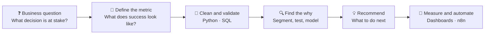

**[About](#-about-me)** · **[Impact](#-impact-at-a-glance)** · **[Approach](#-how-i-approach-a-business-problem)** · **[Projects](#-featured-projects)** · **[Experience](#-experience)** · **[Tech Stack](#-tech-stack)** · **[Contact](#-lets-connect)**

<!-- ============ ABOUT ============ -->
## 👋 About Me

<table>
<tr>
<td width="62%" valign="top">

**I'm a data analyst who starts with the business decision, then works back to the data.**

I have 2+ years in a supply chain advisory team and a Master's in Operational Research. My work is about finding where people lose time or make decisions on weak information, then fixing it with analysis, forecasting and automation.

- 🚢 Research Analyst at **Drewry Shipping Consultants**, working with 70+ enterprise client datasets
- 🎯 I define the question and the metric first, and pick the tools second
- 📊 **Python, SQL, Power BI**, statistical modelling and time-series forecasting
- 🤖 **AI workflows in n8n** with Llama 3.3 on Groq, so non-technical teams can get answers without waiting on an analyst
- 🎓 Master of Operational Research · B.Sc. Statistics (Hons), University of Delhi
- 💬 Ask me about: data validation, forecasting, retention analysis, dashboards, self-serve analytics

</td>
<td width="38%" align="center" valign="middle">

</td>
</tr>
</table>

<!-- ============ IMPACT ============ -->
## 📈 Impact at a Glance

<table>
<tr>
<td width="55%" align="center" valign="middle">

</td>
<td width="45%" valign="middle">

<!--
TODO: add a baseline to each number so it survives interview questions.
e.g. "Reporting cycle: X days down to Y" / "3 hrs saved per week or per run?" / how 25% visibility was measured.
-->

| | |
|---|---|
| 🗂️ **70+** | enterprise client datasets in one automated validation pipeline |
| ⏱️ **90%+** | shorter reporting cycles |
| 👀 **+25%** | cross-team visibility from VBA checks and Power BI dashboards |
| ⚡ **3 hrs** | manual research saved by a GenAI research pipeline |

</td>
</tr>
</table>

<!-- ============ APPROACH ============ -->
## 🧭 How I Approach a Business Problem

| Principle | What it means in practice |
|---|---|
| **Decision first** | Every analysis starts with who will act on it and what they will do differently. |
| **Metric before model** | I agree on what "good" means before building anything, including what a wrong prediction costs. |
| **The why, not just the what** | I segment, test and root-cause rather than report totals. |
| **End with a recommendation** | Every project ends with a next action, an expected impact and what I would test next. |
| **Make it repeatable** | If a task will recur, I automate it so the team's time goes to decisions instead of prep. |

<!-- ============ PROJECTS ============ -->
## 🚀 Featured Projects

Each project is written as a business case: the question, the approach, what I found and what I would recommend.

### 📉 [Customer Churn Analysis ↗](https://github.com/koriurvashi/customer-churn-analysis)
**Question:** Why do subscribers cancel, and where should a retention team focus first?
**What it does:** finds which segments leave most and quantifies the revenue at risk, so effort can be prioritised by impact.
`Python` `SQL` `pandas` `seaborn`

### 💬 [NL2SQL Chat Agent ↗](https://github.com/koriurvashi/nl2sql-chat-agent)
**Question:** How can non-technical teams get answers from data without waiting in an analyst queue?
**What it does:** turns plain-English questions into SQL-backed answers with a short insight, a step towards self-serve analytics.
`n8n` `Llama 3.3` `Groq` `PostgreSQL`

### 🧵 Reddit Post Analysis and Moderation Classifier
**Question:** Can moderation effort be focused on the posts most likely to need it?
**What it does:** EDA with window functions and CTEs, then TF-IDF with Decision Tree and Random Forest (**F1 0.72**), compared against zero-shot classification with Gemini 2.0 Flash (**91% accuracy**).
`Python` `NLP` `scikit-learn` `Power BI`

### 💳 [Credit Card Fraud Detection ↗](https://github.com/koriurvashi/Credit-card-Fraud-Detection)
**Question:** How do you balance catching fraud against blocking genuine customers?
**What it does:** treats the precision and recall trade-off as a cost decision, because a missed fraud and a wrongly blocked customer cost different amounts.
`Python` `scikit-learn`

### 📰 [AI Market News Digest ↗](https://github.com/koriurvashi/ai-market-news-digest)
**Question:** How can a team stay on top of industry news without reading everything?
**What it does:** collects news, filters noise with an LLM and emails a daily summary.
`n8n` `Groq` `Apify` `JavaScript`

<!--
Coming next, once built (uncomment and link):
### 🔻 Funnel and Retention Analysis
Where do users drop off, and which cohorts stay?
### 🧪 A/B Test Analysis
Primary metric, guardrail metrics and sample-size reasoning for an experiment readout.
-->

<!-- ============ EXPERIENCE ============ -->
## 💼 Experience

<table>
<tr>
<td width="70%" valign="top">

<b>Research Analyst · Drewry Shipping Consultants Ltd</b> Supply Chain Advisory · June 2024 to present

 

- ✅ **Data quality at scale:** built an automated validation pipeline across 70+ client datasets, cutting reporting cycles by 90%+.
- 📊 **Visibility for decisions:** hypothesis testing, root-cause analysis, VBA outlier detection and Power BI executive dashboards, lifting cross-team visibility by 25%.
- 📦 **Forecasting:** nowcasting model (Linear Regression and XGBoost Voting Regressor) to predict global container port throughput.
- 🤖 **Cutting manual research:** GenAI research pipeline with Llama 3.3, Groq and n8n that analyses research trends in near real time, saving 3 hours of manual work.
- 💬 **Self-serve analytics:** NL2SQL prototype in n8n so non-technical teams can query data in plain language.

</td>
<td width="30%" align="center" valign="middle">

</td>
</tr>
</table>

## 🎓 Education

- **Master of Operational Research**, Hansraj College, University of Delhi (2024)
- **B.Sc. Statistics (Honours)**, Ramjas College, University of Delhi (2022)

<!-- ============ TECH STACK ============ -->
## 🧰 Tech Stack

<table>
<tr>
<td width="68%" valign="top">

**Languages and data**

**Analytics and BI**

**AI and automation**

</td>
<td width="32%" align="center" valign="middle">

</td>
</tr>
</table>

**Domain strengths:** statistical hypothesis testing · root-cause analysis · predictive modelling · time-series forecasting · NLP for client insights · data storytelling and executive dashboards

<!-- ============ CONTACT ============ -->
## 🤝 Let's Connect

I'm open to **Data Analyst and Product Analyst roles**, and always happy to talk about analytics, forecasting and problems worth solving.

