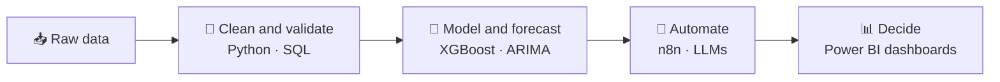

 

---

## 👋 About me

I'm an **analyst with 2+ years in a supply chain advisory team** and a **Master's in Operational Research**.
I like finding a task that people do by hand, again and agaian, and **automating it so it never needs doing twice**.

- 🚢 Research Analyst at **Drewry Shipping Consultants**, Supply Chain Advisory team
- 📊 I work with **Python, SQL, Power BI, statistical modelling and time-series forecasting**
- 🤖 I build **AI workflows with n8n and LLMs** (Llama 3.3 on Groq) that turn hours of research into minutes
- 🎓 Master of Operational Research, University of Delhi · B.Sc. Statistics (Hons), University of Delhi
- 🧠 Hands-on with **LLMs, RAG and agentic workflows**
- 💬 Ask me about: data validation, forecasting, NL2SQL, dashboards, automation

## 📈 Impact at a glance

| 🗂️ **70+** | ⏱️ **90%+** | 👀 **+25%** | ⚡ **3 hrs** |
|:---:|:---:|:---:|:---:|
| enterprise client datasets covered by one automated validation pipeline | shorter reporting cycles | cross-team visibility from VBA outlier checks and Power BI dashboards | manual research saved by a GenAI research pipeline |

## 🔄 How I work

## 🛠️ Tech stack

**Languages and data**

**AI and automation**

**Analytics and BI**

**Domain strengths:** statistical hypothesis testing · root-cause analysis · predictive modelling · time-series forecasting · NLP for client insights · data storytelling and executive dashboards

## 🚀 Featured projects

| Project | What it does | Built with |
|---|---|---|
| 📉 [**Customer Churn Analysis**](https://github.com/koriurvashi/customer-churn-analysis) | Finds why subscribers cancel, which segments leave most, and how much revenue is at risk | Python, SQL, pandas, seaborn |
| 💬 [**NL2SQL Chat Agent**](https://github.com/koriurvashi/nl2sql-chat-agent) | Ask a database questions in plain English and get SQL-backed answers with insight | n8n, Llama 3.3, PostgreSQL |
| 📰 [**AI Market News Digest**](https://github.com/koriurvashi/ai-market-news-digest) | Collects industry news, filters out noise with an LLM, and emails a daily summary | n8n, Groq, Apify, JavaScript |

**Also built:** 🧵 *Reddit Post Analysis and Moderation Classifier* (EDA with window functions and CTEs, TF-IDF, Decision Tree and Random Forest with **F1 0.72**, and zero-shot classification with Gemini 2.0 Flash reaching **91% accuracy**).

## 💼 Experience

<b>Research Analyst · Drewry Shipping Consultants Ltd</b> · Supply Chain Advisory · June 2024 to present

 

- 🤖 **GenAI research pipeline:** built with Llama 3.3, Groq and n8n to analyse research trends in near real time, saving 3 hours of manual research.
- 💬 **NL2SQL prototype:** an n8n-orchestrated agent that turns plain-language questions into SQL so non-technical teams can query data themselves.
- 📦 **Nowcasting model:** a hybrid ensemble of Linear Regression and XGBoost (Voting Regressor) to predict global container port throughput.
- 📊 **Dashboards and checks:** hypothesis testing and root-cause analysis on benchmark datasets, plus automated VBA outlier detection and Power BI executive dashboards, lifting cross-team visibility by 25%.
- ✅ **Validation pipeline:** automated checks across 70+ client datasets, cutting reporting cycles by 90%+ and improving the accuracy of client deliverables.

## 🎓 Education

- **Master of Operational Research**, Hansraj College, University of Delhi (2024)
- **B.Sc. Statistics (Honours)**, Ramjas College, University of Delhi (2022)

## 🤝 Let's connect

I'm happy to talk about analytics, automation and forecasting, or to hear about problems worth automating.

