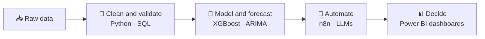

<!-- ============ BANNER ============ -->

**[About](#-about-me)** · **[Impact](#-impact-at-a-glance)** · **[Tech Stack](#-tech-stack)** · **[Projects](#-featured-projects)** · **[Experience](#-experience)** · **[Contact](#-lets-connect)**

<!-- ============ ABOUT ============ -->
## 👋 About Me

<table>
<tr>
<td width="62%" valign="top">

I'm an **analyst with 2+ years in a supply chain advisory team** and a **Master's in Operational Research**.
I like finding a task that people do by hand, again and again, and **automating it so it never needs doing twice**.

- 🚢 Research Analyst at **Drewry Shipping Consultants**
- 📊 **Python, SQL, Power BI**, statistical modelling and time-series forecasting
- 🤖 **AI workflows in n8n** with Llama 3.3 on Groq, turning hours of research into minutes
- 🎓 Master of Operational Research · B.Sc. Statistics (Hons), University of Delhi
- 🧠 Hands-on with **LLMs, RAG and agentic workflows**
- 💬 Ask me about: data validation, forecasting, NL2SQL, dashboards, automation

</td>
<td width="38%" align="center" valign="middle">

</td>
</tr>
</table>

<!-- ============ IMPACT ============ -->
## 📈 Impact at a Glance

<table>
<tr>
<td width="55%" align="center" valign="middle">

</td>
<td width="45%" valign="middle">

| | |
|---|---|
| 🗂️ **70+** | enterprise client datasets in one automated validation pipeline |
| ⏱️ **90%+** | shorter reporting cycles |
| 👀 **+25%** | cross-team visibility from VBA checks and Power BI dashboards |
| ⚡ **3 hrs** | manual research saved by a GenAI research pipeline |

</td>
</tr>
</table>

### 🔄 How I work

<!-- ============ TECH STACK ============ -->
## 🧰 Tech Stack

<table>
<tr>
<td width="68%" valign="top">

**Languages and data**

**AI and automation**

**Analytics and BI**

</td>
<td width="32%" align="center" valign="middle">

</td>
</tr>
</table>

**Domain strengths:** statistical hypothesis testing · root-cause analysis · predictive modelling · time-series forecasting · NLP for client insights · data storytelling and executive dashboards

<!-- ============ PROJECTS ============ -->
## 🚀 Featured Projects

### 📉 [Customer Churn Analysis ↗](https://github.com/koriurvashi/customer-churn-analysis)
Finds why subscribers cancel, which segments leave most, and how much revenue is at risk.
`Python` `SQL` `pandas` `seaborn`

### 💬 [NL2SQL Chat Agent ↗](https://github.com/koriurvashi/nl2sql-chat-agent)
Ask a database questions in plain English and get SQL-backed answers with insight.
`n8n` `Llama 3.3` `Groq` `PostgreSQL`

### 📰 [AI Market News Digest ↗](https://github.com/koriurvashi/ai-market-news-digest)
Collects industry news, filters out noise with an LLM, and emails a daily summary.
`n8n` `Groq` `Apify` `JavaScript`

### 🧵 Reddit Post Analysis and Moderation Classifier
EDA with window functions and CTEs, TF-IDF, Decision Tree and Random Forest (**F1 0.72**), and zero-shot classification with Gemini 2.0 Flash (**91% accuracy**).
`Python` `NLP` `scikit-learn` `Power BI`

<!-- ============ EXPERIENCE ============ -->
## 💼 Experience

<table>
<tr>
<td width="70%" valign="top">

<b>Research Analyst · Drewry Shipping Consultants Ltd</b> Supply Chain Advisory · June 2024 to present

 

- 🤖 **GenAI research pipeline** with Llama 3.3, Groq and n8n to analyse research trends in near real time, saving 3 hours of manual research.
- 💬 **NL2SQL prototype** in n8n that turns plain-language questions into SQL for non-technical teams.
- 📦 **Nowcasting model**: Linear Regression and XGBoost (Voting Regressor) to predict global container port throughput.
- 📊 **Dashboards and checks**: hypothesis testing, root-cause analysis, VBA outlier detection and Power BI executive dashboards, lifting cross-team visibility by 25%.
- ✅ **Validation pipeline** across 70+ client datasets, cutting reporting cycles by 90%+.

</td>
<td width="30%" align="center" valign="middle">

</td>
</tr>
</table>

## 🎓 Education

- **Master of Operational Research**, Hansraj College, University of Delhi (2024)
- **B.Sc. Statistics (Honours)**, Ramjas College, University of Delhi (2022)

<!-- ============ CONTACT ============ -->
## 🤝 Let's Connect

I'm happy to talk about analytics, automation and forecasting, or to hear about problems worth automating.

